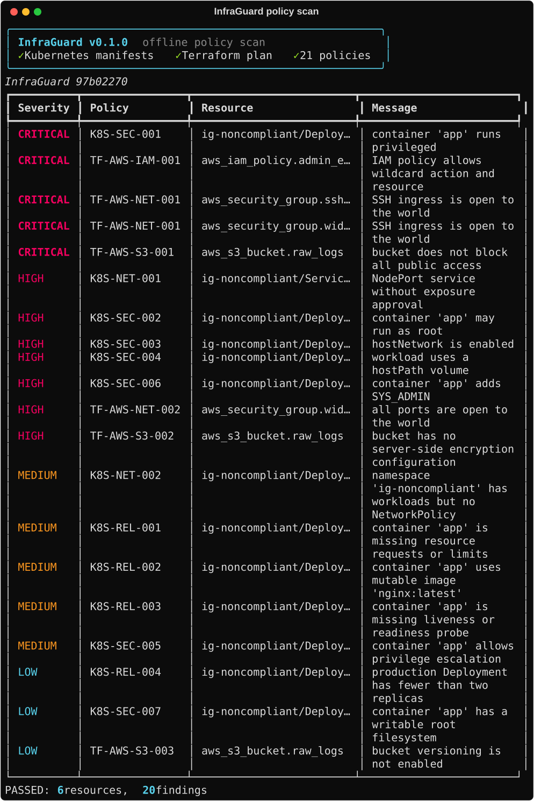
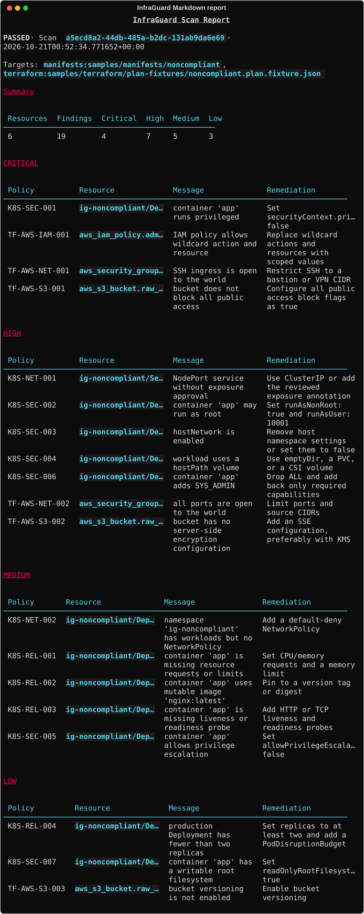
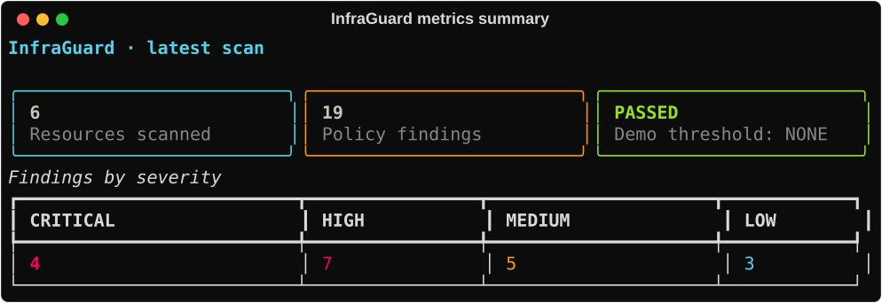
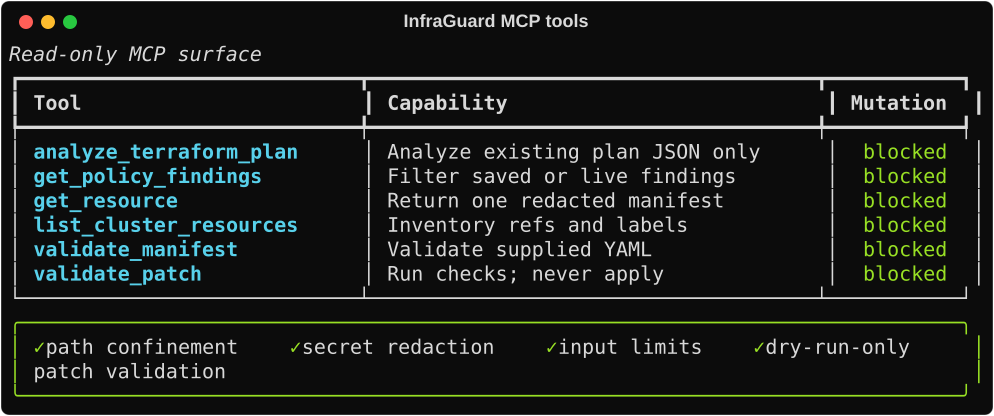
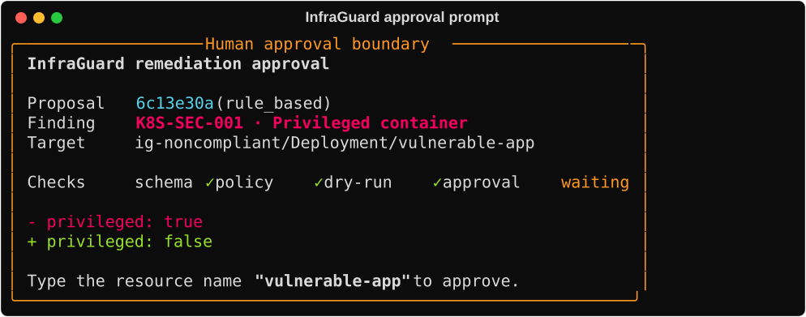
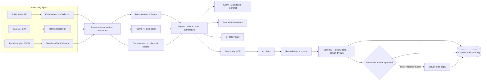

# InfraGuard

> A read-only-first Kubernetes and Terraform policy scanner with deterministic reports, a constrained MCP surface, and human-approved remediation.

[](https://github.com/hfmohammed/infraguard/actions/workflows/ci.yml)
[](pyproject.toml)
[](docs/METRICS.md)
[](docs/POLICIES.md)
[](docs/MCP.md)
[](LICENSE)

InfraGuard demonstrates how a platform team can apply the same guardrails to source manifests, rendered Helm charts, live Kubernetes objects, and Terraform plan JSON. The scanner normalizes every target into immutable models, evaluates security and reliability policy, and emits stable evidence for humans, CI, Prometheus, and AI clients.

The project deliberately treats AI as an untrusted proposer. MCP operations are read-only, secrets are removed at collection boundaries, and a remediation cannot mutate Kubernetes until it passes technical gates and a person approves the exact resource in an interactive terminal.

## What this project demonstrates

| Capability | Implementation evidence |
|---|---|
| Policy engineering | 21 catalogued Kubernetes and Terraform controls, OPA/Rego suites, native cross-resource and plan-risk analysis |
| Platform automation | Ephemeral kind environment, Helm samples, Terraform validation, policy gates, artifacts, and matrix tests in GitHub Actions |
| Secure AI integration | Exactly six MCP tools, path confinement, secret redaction, size limits, and mutation-blocking wrappers |
| Safe remediation | Target-bound Pydantic model → kubeconform → policy delta → server-side dry-run → exact-name TTY approval → server-side apply |
| Operational evidence | Rich terminal output, JSON Schema-backed reports, Markdown, Prometheus exposition, and append-only JSONL audit records |
| Engineering quality | Python 3.11/3.12, strict mypy, Ruff, deterministic ordering, coverage gate, Rego tests, and pinned local toolchain |

## Real output

These captures are regenerated from the committed fixtures and runtime tool registry with `make screenshots`; they are not hand-edited mockups.

### Offline Kubernetes + Terraform scan



### Markdown evidence report



<details>
<summary>Metrics, MCP surface, and remediation approval</summary>







</details>

## Architecture



More detail: [architecture](docs/ARCHITECTURE.md), [MCP threat model](docs/MCP.md), and [remediation guardrails](docs/GUARDRAILS.md).

## Five-minute offline demo

The offline path needs Python 3.11/3.12 and Make; it does not need Docker, a cluster, cloud credentials, or Terraform execution.

```bash
git clone https://github.com/hfmohammed/infraguard.git
cd infraguard

python3.12 -m venv .venv
.venv/bin/pip install -e '.[dev]'

.venv/bin/infraguard validate \
  samples/manifests/noncompliant \
  --plan-json samples/terraform/plan-fixtures/noncompliant.plan.fixture.json \
  --fail-on NONE \
  --format table \
  --format json \
  --format markdown \
  --metrics-file reports/metrics.prom
```

Expected result: six normalized resources, 19 deliberately seeded findings, and reports under `reports/`. `--fail-on NONE` keeps the demonstration command successful while still reporting every violation.

Compare the clean target:

```bash
.venv/bin/infraguard validate samples/manifests/compliant --fail-on LOW
```

## Full local platform demo

Prerequisites: Docker, Python 3.11/3.12, Make, `curl`, `tar`, and `unzip`.

```bash
make setup          # virtualenv + pinned tools in ./bin; no sudo
make cluster-up     # one control-plane and one worker
make deploy-samples # compliant and intentionally vulnerable namespaces
make scan           # terminal + JSON + Markdown + Prometheus
make test           # Python and Rego suites
make cluster-down
```

`scripts/install-tools.sh` detects Darwin/Linux and amd64/arm64, then installs the exact versions in [tools.env](tools.env) locally. Nothing is written system-wide.

## Policy catalog

| Family | Policies | Representative controls |
|---|---:|---|
| Kubernetes security | 7 | privileged/root containers, host namespaces, hostPath, escalation, capabilities, writable root FS |
| Kubernetes reliability | 4 | resource guarantees, immutable images, health probes, production replicas |
| Kubernetes network | 2 | unapproved external Services and missing NetworkPolicy coverage |
| Terraform AWS | 6 | world-open ingress, public/unencrypted/unversioned S3, wildcard IAM |
| Terraform plan risk | 2 | destructive actions and stateful replacement |

Every catalog entry has severity, category, remediation guidance, engine ownership, and a seeded fixture. See the generated [policy reference](docs/POLICIES.md).

The default offline path uses the built-in deterministic evaluator so it remains fast and dependency-light. Rego sources provide Conftest compatibility, while Python handles checks that need joins across the complete inventory or Terraform action semantics.

## CLI

```text
infraguard scan       # live cluster and/or Terraform plan
infraguard validate   # YAML, directories, Helm, and plan JSON
infraguard report     # re-render a saved JSON report
infraguard policies   # inspect or generate the policy catalog
infraguard mcp serve  # start the read-only MCP server
infraguard remediate  # propose, check, or interactively apply
```

Policy thresholds are `CRITICAL`, `HIGH`, `MEDIUM`, `LOW`, and `NONE`.

| Exit | Meaning |
|---:|---|
| 0 | Scan passed its threshold |
| 1 | Findings met or exceeded the threshold, or a remediation gate failed |
| 2 | Invalid CLI usage or configuration |
| 3 | External tool or runtime failure |
| 4 | Approval was rejected or impossible outside an interactive TTY |

Run `.venv/bin/infraguard --help` for the complete command tree.

## Read-only MCP server

The server registers exactly these six tools:

1. `list_cluster_resources`
2. `get_resource`
3. `get_policy_findings`
4. `analyze_terraform_plan`
5. `validate_manifest`
6. `validate_patch`

`validate_patch` performs validation only and always returns `applied: false`. Filesystem arguments must resolve under `--allowed-root`; YAML is capped at 256 KB and 50 documents; results are redacted. The Kubernetes capability wrapper exposes read/list operations and a dry-run-only patch path.

```json
{
  "mcpServers": {
    "infraguard": {
      "command": "infraguard",
      "args": ["mcp", "serve", "--context", "kind-infraguard"]
    }
  }
}
```

## Human-gated remediation

```bash
infraguard remediate propose \
  --report reports/scan-abc12345.json \
  --finding a91c03e7f2b4d611 \
  --out proposal.yaml \
  --context kind-infraguard

infraguard remediate check proposal.yaml --context kind-infraguard
infraguard remediate apply proposal.yaml --context kind-infraguard
```

`check` stops after server-side dry-run. `apply` reruns the gates, refuses noninteractive input, requires the exact resource name, and only then performs server-side apply. Each executed step is appended to `audit/remediation.jsonl`; the manifest itself is never logged, only its SHA-256.

## CI and verification

The GitHub Actions workflow separates concerns:

- **lint**: Ruff, formatting, strict mypy, forbidden-plan detection, and gitleaks;
- **unit**: Python 3.11/3.12 matrix with the 85% coverage gate;
- **policy/IaC validation**: Rego, Helm, kubeconform, Terraform formatting/validation, clean-target checks, and an asserted negative gate;
- **integration**: an ephemeral kind cluster, both Helm releases, live collection, and a compliant namespace gate.

Useful local commands:

```bash
make lint
make test
make validate
make screenshots
./scripts/check_no_plans.sh
```

Measured results—not estimates—are recorded in [docs/METRICS.md](docs/METRICS.md).

## Security model

- Terraform samples are plan-only, use mock credentials, disable provider account checks, and contain no data sources.
- Plans, state, kubeconfigs, credentials, reports, audit logs, caches, and downloaded binaries are gitignored.
- A repository hook and CI check reject tracked Terraform plans/state.
- Kubernetes Secrets lose `data` and `stringData`; sensitive environment values are replaced before models, reports, or MCP output are built.
- The recommended Kubernetes role grants `get`, `list`, and `watch` but cannot read Secrets.
- No subprocess uses a shell; YAML uses safe loaders; MCP paths are canonicalized before access.
- Remediation is the only mutation path, and it cannot bypass interactive approval.

See [security and guardrail details](docs/GUARDRAILS.md).

## Repository map

```text
src/infraguard/       collectors, validators, engine, reports, MCP, remediation
policies/             metadata plus Kubernetes and Terraform Rego
samples/              Helm, raw YAML, sanitized plans, Terraform, remediation
tests/                unit, integration, policy matrix, golden expectations
cluster/              kind topology and least-privilege Kubernetes RBAC
dashboards/           optional Prometheus/Grafana development stack
docs/                 architecture, policy, MCP, guardrail, and metric evidence
```

## Roadmap

- SARIF output and GitHub code-scanning upload
- Kustomize rendering
- Optional AWS/GCP read-only inventory collectors with mocked test suites
- Fully provisioned Grafana dashboards
- Optional local Ollama proposer while preserving the same guardrail pipeline

## License

[MIT](LICENSE)
