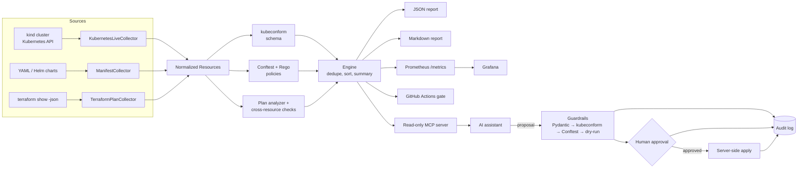

# InfraGuard

> Kubernetes and Terraform guardrails with deterministic policy reports and human-approved remediation.

[](https://github.com/hfmohammed/infraguard/actions/workflows/ci.yml)  [](LICENSE)

## Why

Infrastructure mistakes are cheapest to fix before deployment, but useful guardrails must work against both proposed changes and live environments. InfraGuard normalizes Kubernetes and Terraform inputs, applies one consistent policy catalog, and produces evidence that CI and humans can understand. Its AI-facing surface is read-only, while proposed remediations pass four technical gates and explicit human approval before any mutation.

## Features

- Collects YAML, Helm output, live Kubernetes resources, and Terraform plan JSON.
- Evaluates 21 security, reliability, network, schema, and change-risk policies.
- Produces stable terminal, JSON, Markdown, and Prometheus output.
- Gates pull requests through an ephemeral kind cluster in GitHub Actions.
- Exposes exactly six read-only MCP tools for infrastructure inspection.
- Guards remediation with schema, policy, dry-run, approval, and audit controls.

## Architecture



## Quickstart

Prerequisites: Docker, Python 3.11 or 3.12, and Make.

```bash
git clone https://github.com/hfmohammed/infraguard
cd infraguard
make setup
make cluster-up
make deploy-samples
make scan
make test
make cluster-down
```

For a fast offline demonstration:

```bash
infraguard validate samples/manifests/noncompliant \
  --plan-json samples/terraform/plan-fixtures/noncompliant.plan.fixture.json \
  --fail-on NONE --format table --format json --format markdown
```

## Sample output

```text
Severity  Policy           Resource                                  Message
CRITICAL  K8S-SEC-001      ig-noncompliant/Deployment/vulnerable-app container 'app' runs privileged
CRITICAL  TF-AWS-NET-001   aws_security_group.ssh_open               SSH ingress is open to the world
CRITICAL  TF-AWS-S3-001    aws_s3_bucket.raw_logs                    bucket does not block all public access
PASSED: 6 resources, 21 seeded policy findings (--fail-on NONE)
```

The Markdown report groups findings by severity and includes validator timing, resources checked, remediation guidance, and a stable resource key.

## Policy catalog

| Family | Count | Examples |
|---|---:|---|
| Kubernetes security | 7 | privileged, root, host namespace, capabilities |
| Kubernetes reliability | 4 | resources, image tags, probes, replicas |
| Kubernetes network | 2 | public services, NetworkPolicy coverage |
| Terraform AWS | 6 | ingress, public/unencrypted S3, wildcard IAM |
| Terraform plan risk | 2 | destroy/replace, stateful replacement |

See [docs/POLICIES.md](docs/POLICIES.md) for the complete generated catalog.

## CLI reference

- `infraguard scan`: live Kubernetes and optional Terraform collection.
- `infraguard validate`: offline YAML, Helm, and plan validation.
- `infraguard report`: re-render saved JSON.
- `infraguard policies list`: table, JSON, or Markdown metadata.
- `infraguard mcp serve`: start the read-only AI integration.
- `infraguard remediate propose|check|apply`: guarded fixes.

Exit codes are 0 for pass, 1 for policy gate failure, 2 for usage errors, 3 for runtime/tool errors, and 4 for refused or impossible approval.

## Metrics and Grafana

Use `--metrics-file reports/metrics.prom` to export violation, severity, resource, duration, and last-scan metrics. `make dashboards-up` starts the optional local Prometheus/Grafana stack.

## MCP server

The server offers six tools: list and get cluster resources, get findings, analyze a plan, validate a manifest, and validate a patch. It caps inputs, guards paths, redacts secrets, blocks mutating client methods, and audits calls.

```json
{"mcpServers": {"infraguard": {"command": "infraguard", "args": ["mcp", "serve", "--context", "kind-infraguard"]}}}
```

## Guarded remediation

Every proposal passes Pydantic validation, kubeconform, policy comparison, and Kubernetes server-side dry-run. Only an interactive human who types the exact resource name can authorize apply. Each executed step writes only metadata and the manifest hash to `audit/remediation.jsonl`.

## CI

The workflow runs formatting and strict typing, offline tests and policy checks, Helm/Terraform validation, then deploys both sample charts to kind for integration tests and a compliant-target policy gate.

## Security notes

Terraform samples are plan-only and use mock credentials; plans and state are blocked from git. Kubernetes collection is read-only, secrets are stripped at collection boundaries, MCP paths are confined to the repository, and the sample RBAC role cannot read Secrets. Never run `terraform apply` against the samples.

## Screenshots

<!-- TODO: replace with a real screenshot -->

<!-- TODO: replace with a real screenshot -->

<!-- TODO: replace with a real screenshot -->

<!-- TODO: replace with a real screenshot -->

<!-- TODO: replace with a real screenshot -->

<!-- TODO: replace with a real screenshot -->


## Results

See [docs/METRICS.md](docs/METRICS.md) for reproducible measurements. Unavailable CI and live-cluster measurements are marked pending rather than estimated.

## Roadmap

SARIF, Kustomize, optional read-only AWS and GCP inventory, a provisioned Grafana stack, and an opt-in local Ollama proposer.

## License

[MIT](LICENSE)

